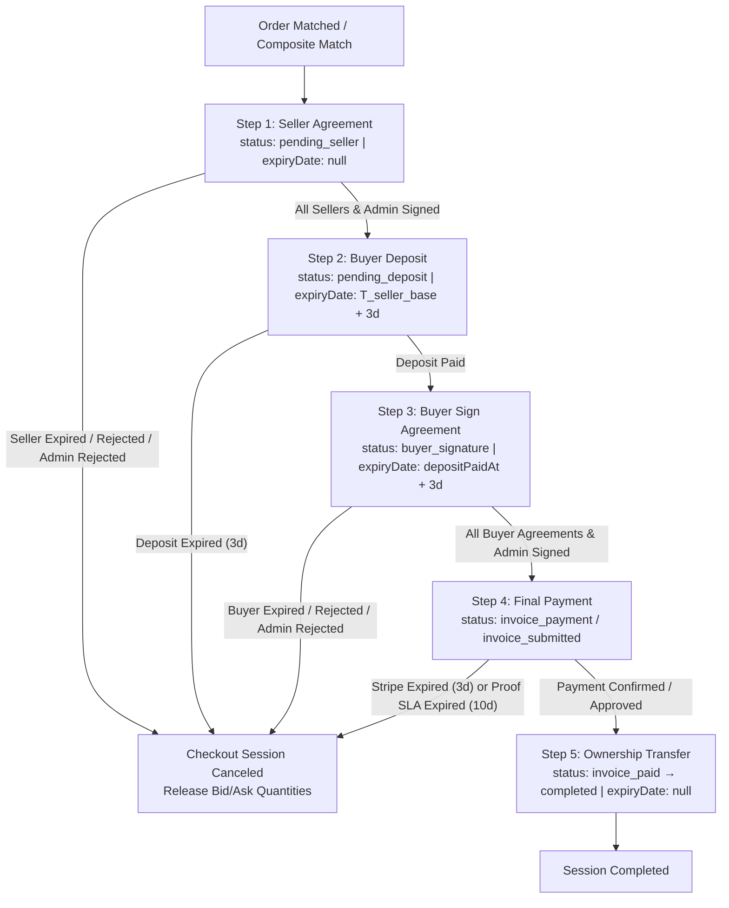
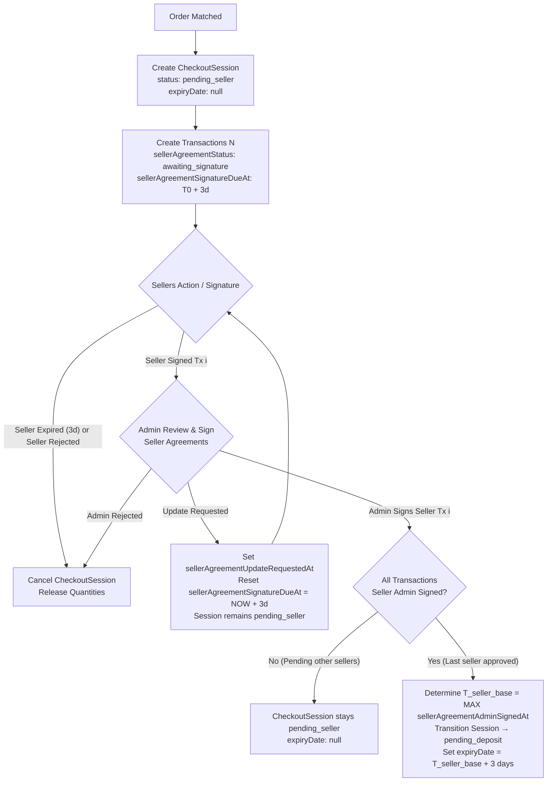
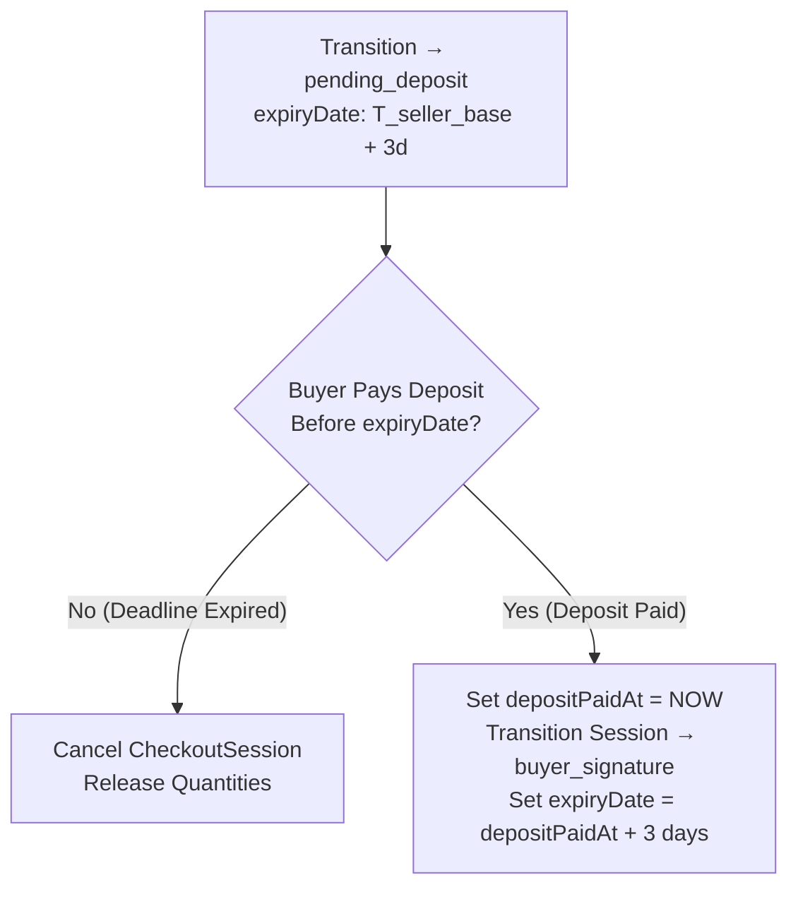
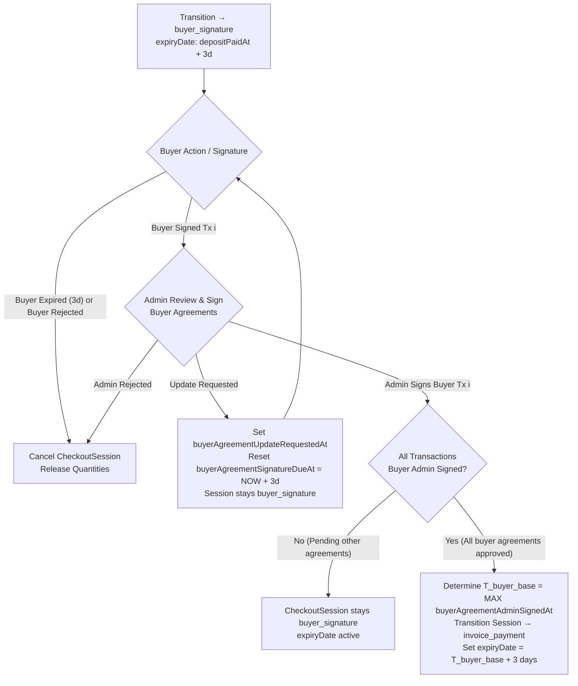
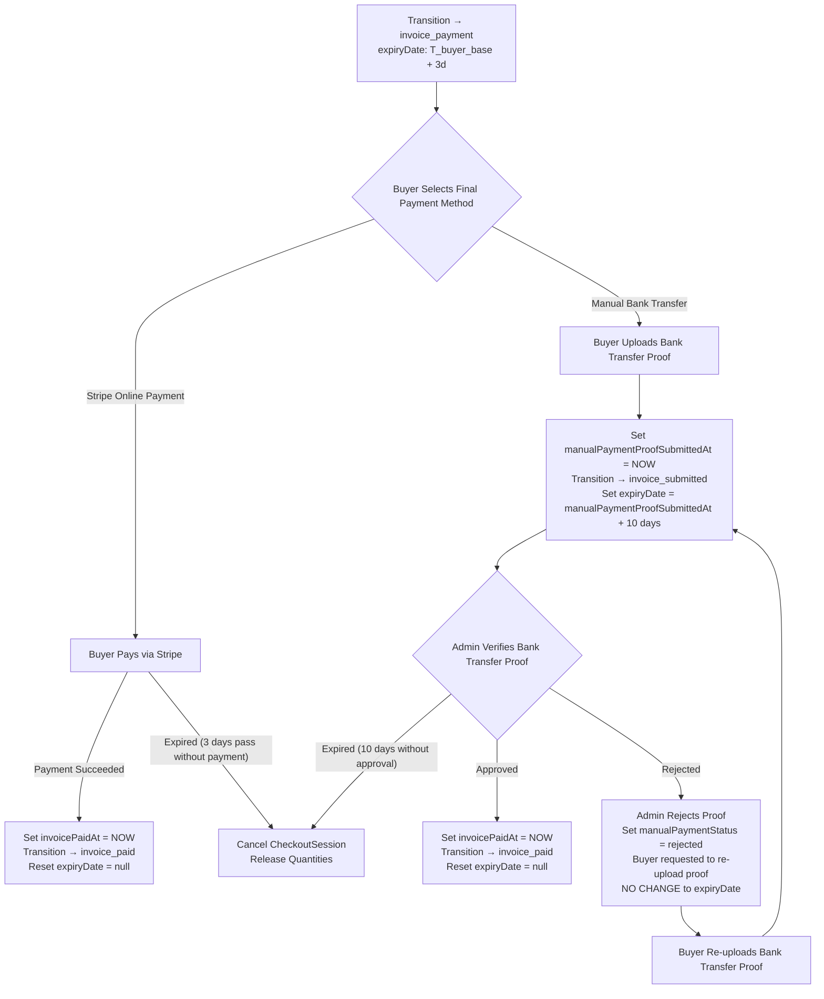
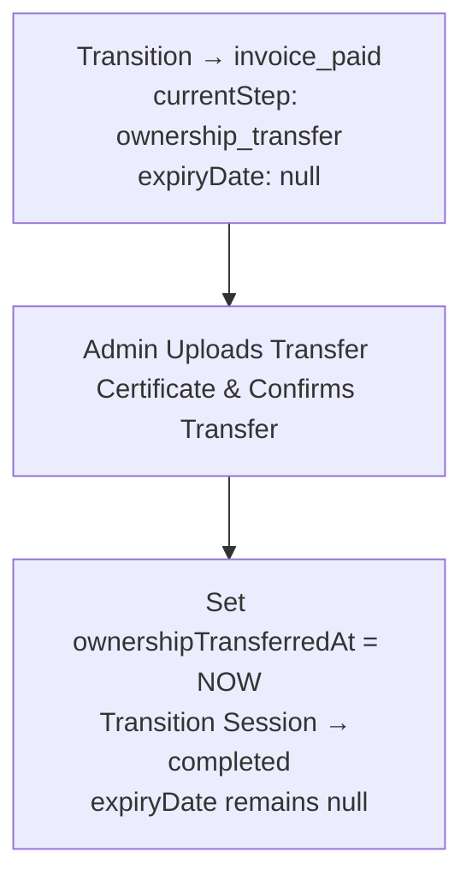

# Backend Specification: Checkout Session Initial Status `pending_seller` & Milestone Deadline Rules

## 1. Overview & System Context

This document outlines the technical design and API updates required for the Backend (BE) transaction engine regarding initial Checkout Session creation, status transitions, and dynamic expiry timestamp calculations.

### 1.1 Background & Problem Statement
Previously, upon successful order matching (either 1:1 or 1:N composite matches), the system initialized a `CheckoutSession` in the `pending` status with `expiryDate` set immediately to `createdAt + 3 days`.

However, the Post-Match workflow requires Seller(s) to sign their Release Form / Agreement before the Buyer pays the deposit:
1. **Seller Signs Agreement** (Requires Admin review & signature)
2. **Buyer Deposit Payment** (Requires active payment window)
3. **Buyer Signs Agreement**
4. **Buyer Remaining Payment (Final Payment)**
5. **Ownership Transfer** (Admin uploads transfer certificates)

Static initialization of `expiryDate` at Checkout Session creation created a race condition: if Seller(s) or Admin took 2 days to review and sign agreements, the Buyer was left with less than 24 hours to complete their deposit before the Checkout Session expired.

### 1.2 Solution Summary
- **New Initial Status:** Introduce `pending_seller` as the initial status of a newly created `CheckoutSession`.
- **Frontend (FE) Mapping:** `pending_seller` maps to `Pending` on the Buyer/Seller Frontend UI.
- **Null Expiry Window at Start:** While in `pending_seller`, `expiryDate` on `CheckoutSession` is explicitly set to `null` (since the deposit timer should not run while awaiting seller signatures).
- **Dynamic Deposit Base Timestamp:** When all seller agreements for a Checkout Session are signed by sellers and approved by Admin (`sellerAgreementAdminSignedAt`), the Checkout Session transitions to the deposit payment step. For multi-transaction checkout sessions (1 Checkout Session containing $N$ Transactions), the base reference timestamp ($T_{\text{seller\_base}}$) for calculating the 3-day deposit deadline is the `sellerAgreementAdminSignedAt` of the **seller transaction signed by Admin last**:
  $$\text{expiryDate} = \max_{i \in \{1 \dots N\}}(\text{Transaction}_i.\text{sellerAgreementAdminSignedAt}) + 3\text{ days}$$
- **Buyer Agreement Base Timestamp & Cancellation Rules:** Upon deposit payment, the session transitions to `buyer_signature` step with `expiryDate = depositPaidAt + 3 days`. In Direct Matches (total value > £30,000) with $N$ buyer agreements, the Buyer signs $N$ agreements and Admin reviews/approves $N$ agreements. If the Buyer fails to sign before deadline or rejects any agreement, or if Admin rejects any buyer agreement, the session and all related transactions are cancelled. When Admin approves all buyer agreements, the base reference timestamp ($T_{\text{buyer\_base}}$) for calculating the 3-day final payment deadline is the `buyerAgreementAdminSignedAt` of the **buyer agreement approved by Admin last**:
  $$\text{expiryDate} = \max_{i \in \{1 \dots N\}}(\text{Transaction}_i.\text{buyerAgreementAdminSignedAt}) + 3\text{ days}$$
  *(Note: For Indirect Matches with 1 session-level buyer agreement, $\text{expiryDate} = \text{buyerDocuSignAdminSignedAt} + 3\text{ days}$)*.
- **Final Payment Dual Flows & Proof Verification SLA:**
  - **Stripe Online Payment Flow:** Upon receiving online payment (Stripe webhook confirmation), `invoicePaidAt` is set to `NOW`, session transitions to `invoice_paid`, and `expiryDate` is reset to `null`.
  - **Manual Bank Transfer Flow:** If the Buyer selects Bank Transfer and uploads proof, `manualPaymentProofSubmittedAt = NOW`, session transitions to `invoice_submitted`, and `expiryDate` is set to 10 days from submission:
    $$\text{expiryDate} = \text{manualPaymentProofSubmittedAt} + 10\text{ days}$$
    This provides a 10-day SLA window for Admin/Finance to verify the bank transfer proof.
  - **Bank Transfer Proof Rejection & Resubmission:** If Admin rejects the bank transfer proof, the Buyer is requested to re-upload payment proof. Crucially, **re-submitting proof does NOT reset or extend `expiryDate`**; the 10-day deadline remains fixed based on the initial `manualPaymentProofSubmittedAt`.
- **Post-Final Payment Null Expiry:** Once the **Final Payment (Remaining Payment)** is approved/completed (`invoicePaidAt !== null` / status `invoice_paid`), the `expiryDate` on `CheckoutSession` returns/resets to **`null`** during the subsequent Ownership Transfer and Completion steps, as no further payment or signing deadline applies to the Buyer/Seller.

---

## 2. High-Level & Detailed Flow Overview

### 2.1 High-Level Overview Flowchart (Macro Milestones)



---

### 2.2 Step 1 Detail: Seller Agreement Flow (`pending_seller`)



---

### 2.3 Step 2 Detail: Buyer Deposit Flow (`pending_deposit`)



---

### 2.4 Step 3 Detail: Buyer Agreement Signing Flow (`buyer_signature`)



---

### 2.5 Step 4 Detail: Final Payment Flow (`invoice_payment` & `invoice_submitted`)



---

### 2.6 Step 5 Detail: Ownership Transfer & Completion Flow (`invoice_paid` -> `completed`)



---

## 3. Multi-Party Interaction Matrix (Buyer, Seller, Admin, System)

The following table details the end-to-end interactions across all parties for each phase:

| Phase / Action | Initiating Party | Opposite Party Experience | Admin Experience | System Handling & Automation |
| :--- | :--- | :--- | :--- | :--- |
| **1. Order Creation** | Buyer (Bid) / Seller (Ask) | Sees trade notification; Checkout session generated. | Sees newly created transaction(s) in Admin Portal. | 1. Generates `CheckoutSession` (`status = pending_seller`, `expiryDate = null`).<br>2. Generates `Transaction`(s) (`sellerAgreementStatus = awaiting_signature`, `sellerAgreementSignatureDueAt = NOW + 3d`).<br>3. Triggers DocuSign envelope generation for Seller(s). |
| **2. Seller Agreement Signature** | Seller | Buyer UI displays status `Pending` ("Awaiting Seller Signature"). | Admin receives alert: "Seller Agreement signed, pending Admin approval". | Updates `sellerAgreementStatus = signed` and records `sellerAgreementSignedAt = NOW`. |
| **3A. Admin Approves Seller Signature** | Admin | If other sellers pending: Buyer UI remains `Pending`. If last seller signed: Buyer receives notification to pay deposit. | Admin signs release form; `sellerAgreementAdminSignedAt = NOW`. | 1. Checks if all transactions in CheckoutSession have `sellerAgreementAdminSignedAt != null`.<br>2. **If ALL signed:** Calculates $T_{\text{seller\_base}} = \max(\text{sellerAgreementAdminSignedAt})$.<br>3. Updates `CheckoutSession.status = pending_deposit` (or `pending` on FE), `currentStep = deposit_payment`, and `expiryDate = T_{\text{seller\_base}} + 3\text{ days}`.<br>4. Initializes Stripe PaymentIntent for deposit. |
| **3B. Admin Requests Agreement Revision** | Admin | Seller receives notification with revision reason; signature reset. | Tracks revision history and reason. | 1. Sets `sellerAgreementUpdateRequestedAt = NOW`.<br>2. Resets `sellerAgreementSignatureDueAt = NOW + 3 days`.<br>3. `CheckoutSession.status` remains `pending_seller`, `expiryDate` remains `null`. |
| **3C. Seller Signature Expires / Rejected** | System / Seller / Admin | Both Buyer and Seller receive cancellation notifications. | Transaction marked as `CANCELED` / `EXPIRED`. | 1. Transitions `sellerAgreementStatus` to `expired` or `rejected` (or `sellerAgreementAdminRejectedAt` set).<br>2. Cascades cancellation to `CheckoutSession` (`status = canceled`).<br>3. Reverts/releases quantity to active Bids/Asks according to expiration specifications. |
| **4. Buyer Deposit Payment** | Buyer | Seller sees deposit status updated to `Paid`. | Admin views payment confirmation in dashboard. | 1. Sets `depositPaidAt = NOW`.<br>2. Transitions `CheckoutSession` to `buyer_signature` step.<br>3. Calculates next milestone deadline (`expiryDate = depositPaidAt + 3 days`). |
| **4B. Buyer Agreement Signature** | Buyer | Seller sees status "Awaiting Buyer Signature / Admin Review". | Admin receives alert: "Buyer Agreement signed, pending Admin review". | 1. Updates `buyerAgreementStatus = buyer_signed` and `buyerAgreementSignedAt = NOW`. |
| **4C. Admin Approves Buyer Signature** | Admin | If other buyer agreements pending: Session stays `buyer_signature`. If all signed: Buyer receives prompt for Final Payment. | Admin signs buyer agreement; `buyerAgreementAdminSignedAt = NOW`. | 1. Checks if all buyer agreements in session are admin-signed (`buyerAgreementAdminSignedAt != null`).<br>2. **If ALL signed:** Calculates $T_{\text{buyer\_base}} = \max(\text{buyerAgreementAdminSignedAt})$.<br>3. Updates `CheckoutSession.status = invoice_payment`, `currentStep = invoice_payment`, and `expiryDate = T_{\text{buyer\_base}} + 3\text{ days}`. |
| **4D. Buyer Signature Expired / Rejected** | System / Buyer / Admin | Both Buyer and Seller receive cancellation notifications. | Session & transactions marked as `CANCELED` / `EXPIRED`. | 1. Sets `buyerAgreementStatus` to `expired` / `rejected` (or `buyerDocuSignAdminRejectedAt` set).<br>2. Cascades cancellation to `CheckoutSession` (`status = canceled`).<br>3. Releases allocated quantities back to active Bids/Asks. |
| **5A. Final Payment - Stripe Payment Success** | Buyer / System Webhook | Seller & Buyer see status updated to `Paid` / `Transferring Ownership`. | Admin receives notification to initiate Ownership Transfer. | 1. Sets `invoicePaidAt = NOW`.<br>2. Transitions `CheckoutSession.status = invoice_paid`, `currentStep = ownership_transfer`.<br>3. **Resets `CheckoutSession.expiryDate = null`**. |
| **5B. Final Payment - Bank Transfer Proof Upload** | Buyer | Seller sees status "Payment Proof Uploaded, Awaiting Admin Verification". | Admin receives notification & alert to verify bank transfer proof (10-day SLA). | 1. Sets `manualPaymentProofSubmittedAt = NOW` (if initial submission).<br>2. Sets `manualPaymentEvidenceUrl`.<br>3. Transitions `CheckoutSession.status = invoice_submitted`.<br>4. Sets `CheckoutSession.expiryDate = manualPaymentProofSubmittedAt + 10 days`. |
| **5C. Final Payment - Admin Approves Bank Transfer Proof** | Admin | Buyer & Seller see status updated to `Paid` / `Transferring Ownership`. | Admin confirms payment & proceeds to Ownership Transfer. | 1. Sets `invoicePaidAt = NOW`.<br>2. Transitions `CheckoutSession.status = invoice_paid`, `currentStep = ownership_transfer`.<br>3. **Resets `CheckoutSession.expiryDate = null`**. |
| **5D. Final Payment - Admin Rejects Bank Transfer Proof** | Admin | Buyer receives alert to re-upload bank transfer proof. | Admin specifies rejection reason. | 1. Sets `manualPaymentStatus = rejected`.<br>2. Session allows Buyer to re-upload proof.<br>3. **`expiryDate` remains unchanged** ($T_{\text{proof\_initial}} + 10\text{ days}$). |
| **6. Ownership Transfer Completion** | Admin | Buyer and Seller view transaction as `Completed`; ownership certificate uploaded. | Admin uploads transfer documents and confirms ownership transfer. | 1. Sets `ownershipTransferredAt = NOW`.<br>2. Transitions `CheckoutSession.status = completed`.<br>3. **`CheckoutSession.expiryDate` remains `null`**. |

---

## 4. Detailed State & Inventory Transition Matrix (Use Cases)

Below are the exact before-and-after states for Bid/Ask inventory, Transaction attributes, and Checkout Session properties across all key scenarios.

### Legend & Field Notation
- **Bid / Ask:** `status`, `filled_qty`, `remaining_qty`
- **Transaction:** `sellerAgreementStatus`, `sellerAgreementSignatureDueAt`, `sellerAgreementAdminSignedAt`
- **Checkout Session:** `status`, `currentStep`, `expiryDate`

---

### Use Case 1: Post-Match Checkout Session Creation (1 Buyer matched with 2 Sellers)
- **Initial Scenario:** Buyer places Bid for `qty = 5`. Matched with Seller A (`qty = 3`) and Seller B (`qty = 2`).

| Entity | State BEFORE Event | Event / Action | State AFTER Event |
| :--- | :--- | :--- | :--- |
| **Bid** | `status: active`, `filled_qty: 0`, `remaining_qty: 5` | Order Matching Engine executes composite match | `status: filled` (or `matched`), `filled_qty: 5`, `remaining_qty: 0` |
| **Ask A** | `status: active`, `filled_qty: 0`, `remaining_qty: 3` | Matched with Bid | `status: filled`, `filled_qty: 3`, `remaining_qty: 0` |
| **Ask B** | `status: active`, `filled_qty: 0`, `remaining_qty: 2` | Matched with Bid | `status: filled`, `filled_qty: 2`, `remaining_qty: 0` |
| **Checkout Session** | *(Does not exist)* | System creates Checkout Session | `status: pending_seller` *(FE: Pending)*<br>`currentStep: seller_signature`<br>**`expiryDate: null`** |
| **Transaction A** | *(Does not exist)* | System creates Transaction A | `sellerAgreementStatus: awaiting_signature`<br>`sellerAgreementSignatureDueAt: T0 + 3 days`<br>`sellerAgreementAdminSignedAt: null` |
| **Transaction B** | *(Does not exist)* | System creates Transaction B | `sellerAgreementStatus: awaiting_signature`<br>`sellerAgreementSignatureDueAt: T0 + 3 days`<br>`sellerAgreementAdminSignedAt: null` |

---

### Use Case 2: Partial Seller Signatures (Seller A signs, Admin approves; Seller B pending)
- **Event:** Seller A signs at `T1 = T0 + 1d`. Admin approves and signs Transaction A at `T1_admin = T0 + 1d 2h`.

| Entity | State BEFORE Event | Event / Action | State AFTER Event |
| :--- | :--- | :--- | :--- |
| **Transaction A** | `sellerAgreementStatus: awaiting_signature`, `sellerAgreementAdminSignedAt: null` | Admin signs Release Form A | `sellerAgreementStatus: signed`<br>`sellerAgreementAdminSignedAt: T1_admin` |
| **Transaction B** | `sellerAgreementStatus: awaiting_signature`, `sellerAgreementAdminSignedAt: null` | No action yet | `sellerAgreementStatus: awaiting_signature`<br>`sellerAgreementAdminSignedAt: null` |
| **Checkout Session** | `status: pending_seller`, `expiryDate: null` | System evaluates: Transaction B is still pending Admin signature | **`status: pending_seller`** *(FE: Pending)*<br>`currentStep: seller_signature`<br>**`expiryDate: null`** |
| **Bid / Asks** | `filled_qty: 5`, `remaining_qty: 0` | No change | Unchanged |

---

### Use Case 3: Final Seller Signature & Admin Approval (Seller B signs, Admin approves - Trigger Deposit Window)
- **Event:** Seller B signs at `T2`. Admin approves and signs Transaction B at `T2_admin = T0 + 2d 4h` (Later than Transaction A's `T1_admin`).

| Entity | State BEFORE Event | Event / Action | State AFTER Event |
| :--- | :--- | :--- | :--- |
| **Transaction A** | `sellerAgreementStatus: signed`, `sellerAgreementAdminSignedAt: T1_admin` | Already signed | `sellerAgreementStatus: signed`<br>`sellerAgreementAdminSignedAt: T1_admin` |
| **Transaction B** | `sellerAgreementStatus: awaiting_signature`, `sellerAgreementAdminSignedAt: null` | Admin signs Release Form B | `sellerAgreementStatus: signed`<br>`sellerAgreementAdminSignedAt: T2_admin` |
| **Checkout Session** | `status: pending_seller`, `expiryDate: null` | All transactions signed. System finds $T_{\text{base}} = \max(\text{T1\_admin}, \text{T2\_admin}) = \text{T2\_admin}$ | **`status: pending_deposit`** *(or `pending` on FE)*<br>`currentStep: deposit_payment`<br>**`expiryDate: T2_admin + 3 days`** |
| **Bid / Asks** | `filled_qty: 5`, `remaining_qty: 0` | No change | Unchanged |

---

### Use Case 4: Admin Requests Seller Agreement Revision
- **Event:** Admin reviews Seller A's signature and requests updates (e.g., incorrect signature or missing document) at `T_rev`.

| Entity | State BEFORE Event | Event / Action | State AFTER Event |
| :--- | :--- | :--- | :--- |
| **Transaction A** | `sellerAgreementStatus: awaiting_signature`, `sellerAgreementSignatureDueAt: T0 + 3d` | Admin triggers `Request Update` | `sellerAgreementStatus: awaiting_signature`<br>`sellerAgreementUpdateRequestedAt: T_rev`<br>`sellerAgreementSignatureDueAt: T_rev + 3 days` |
| **Checkout Session** | `status: pending_seller`, `expiryDate: null` | Revision requested for Seller A | **`status: pending_seller`** *(FE: Pending)*<br>`currentStep: seller_signature`<br>**`expiryDate: null`** |

---

### Use Case 5: Seller Agreement Expiration / Rejection (Cascade Cancellation & Quantity Release)
- **Event:** Seller B fails to sign before `sellerAgreementSignatureDueAt` expires at `T_exp`.

| Entity | State BEFORE Event | Event / Action | State AFTER Event |
| :--- | :--- | :--- | :--- |
| **Transaction B** | `sellerAgreementStatus: awaiting_signature` | Expiration Cron / Worker executes | `sellerAgreementStatus: expired`<br>`sellerAgreementExpiredAt: T_exp` |
| **Transaction A** | `sellerAgreementStatus: signed` | Cascading cancellation triggered | `sellerAgreementStatus: canceled` |
| **Checkout Session** | `status: pending_seller`, `expiryDate: null` | Cascading cancellation triggered | `status: canceled`<br>`expiryDate: null` |
| **Bid (Buyer)** | `status: filled`, `filled_qty: 5`, `remaining_qty: 0` | Revert allocated quantity (if Bid not expired) | `status: active`<br>`filled_qty: 0`, `remaining_qty: 5` |
| **Ask A (Seller A)**| `status: filled`, `filled_qty: 3`, `remaining_qty: 0` | Revert allocated quantity (if Ask not expired) | `status: active`<br>`filled_qty: 0`, `remaining_qty: 3` |
| **Ask B (Seller B)**| `status: filled`, `filled_qty: 2`, `remaining_qty: 0` | Revert allocated quantity (if Ask not expired) | `status: active`<br>`filled_qty: 0`, `remaining_qty: 2` |

---

### Use Case 6: Buyer Deposit Expiration (Deposit Not Paid by Dynamic Deadline)
- **Initial State:** Session is in `pending_deposit` with `expiryDate = T2_admin + 3 days`. Current time reaches `T_exp = T2_admin + 3 days` without deposit.

| Entity | State BEFORE Event | Event / Action | State AFTER Event |
| :--- | :--- | :--- | :--- |
| **Checkout Session** | `status: pending_deposit`, `expiryDate: T2_admin + 3d` | Expiration Scheduler fires at `expiryDate` | `status: expired`<br>`expiryDate: T2_admin + 3d` |
| **Transaction A & B**| `sellerAgreementStatus: signed` | Cascading cancellation triggered | `sellerAgreementStatus: canceled` |
| **Bid & Asks** | `filled_qty: 5`, `remaining_qty: 0` | Inventory release logic executed | Quantities released back to active Bids/Asks (if not expired) |

---

### Use Case 6B: Buyer Agreement Signing & Admin Approval (Direct Match Multi-Transaction)
- **Event:** Buyer pays deposit at `T_dep`. System sets `expiryDate = T_dep + 3d`. Buyer signs Agreement A (`T_buyer_a`) and Agreement B (`T_buyer_b`). Admin approves Agreement A at `T_admin_a` and Agreement B at `T_admin_b = T_dep + 1d 5h` ($T_{\text{admin\_b}} > T_{\text{admin\_a}}$).

| Entity | State BEFORE Event | Event / Action | State AFTER Event |
| :--- | :--- | :--- | :--- |
| **Transaction A** | `buyerAgreementStatus: sent` | Admin approves Buyer Agreement A | `buyerAgreementStatus: completed`<br>`buyerAgreementAdminSignedAt: T_admin_a` |
| **Transaction B** | `buyerAgreementStatus: sent` | Admin approves Buyer Agreement B | `buyerAgreementStatus: completed`<br>`buyerAgreementAdminSignedAt: T_admin_b` |
| **Checkout Session** | `status: buyer_signature`, `expiryDate: T_dep + 3d` | All buyer agreements approved. System finds $T_{\text{buyer\_base}} = \max(\text{T\_admin\_a}, \text{T\_admin\_b}) = \text{T\_admin\_b}$ | **`status: invoice_payment`**<br>`currentStep: invoice_payment`<br>**`expiryDate: T_admin_b + 3 days`** |

---

### Use Case 6C: Buyer Agreement Expiration / Rejection / Admin Rejection
- **Event:** Buyer fails to sign Agreement B before deadline or rejects it (or Admin rejects Agreement B).

| Entity | State BEFORE Event | Event / Action | State AFTER Event |
| :--- | :--- | :--- | :--- |
| **Transaction B** | `buyerAgreementStatus: sent` | Expiration Cron / Rejection triggered | `buyerAgreementStatus: expired` (or `rejected`) |
| **Transaction A** | `buyerAgreementStatus: completed` | Cascading cancellation triggered | `buyerAgreementStatus: canceled` |
| **Checkout Session** | `status: buyer_signature` | Cascading cancellation triggered | `status: canceled`<br>`expiryDate: null` |
| **Bid & Asks** | Allocated quantities | Inventory release logic executed | Quantities released back to active Bids/Asks |

---

### Use Case 7A: Final Payment - Online Stripe Payment Success
- **Event:** Buyer pays remaining balance online via Stripe at `T_stripe`.

| Entity | State BEFORE Event | Event / Action | State AFTER Event |
| :--- | :--- | :--- | :--- |
| **Checkout Session** | `status: invoice_payment`, `expiryDate: T_buyer_base + 3d` | Stripe webhook confirms payment success | **`status: invoice_paid`**<br>`currentStep: ownership_transfer`<br>`invoicePaidAt: T_stripe`<br>**`expiryDate: null`** |
| **Transaction A & B**| `payoutStatus: not_ready` | System prepares payouts | `payoutStatus: ready` |

---

### Use Case 7B: Final Payment - Bank Transfer Proof Submission
- **Event:** Buyer selects Bank Transfer and uploads proof of payment at `T_proof`.

| Entity | State BEFORE Event | Event / Action | State AFTER Event |
| :--- | :--- | :--- | :--- |
| **Checkout Session** | `status: invoice_payment`, `expiryDate: T_buyer_base + 3d` | Buyer uploads proof (`manualPaymentEvidenceUrl`) | **`status: invoice_submitted`**<br>`manualPaymentProofSubmittedAt: T_proof`<br>**`expiryDate: T_proof + 10 days`** |
| **Transaction A & B**| `payoutStatus: not_ready` | Awaiting payment verification | `payoutStatus: not_ready` |

---

### Use Case 7C: Final Payment - Admin Proof Verification & Approval
- **Event:** Admin verifies bank transfer proof and approves payment at `T_paid` (within the 10-day window).

| Entity | State BEFORE Event | Event / Action | State AFTER Event |
| :--- | :--- | :--- | :--- |
| **Checkout Session** | `status: invoice_submitted`, `expiryDate: T_proof + 10d` | Admin approves manual bank transfer | **`status: invoice_paid`**<br>`currentStep: ownership_transfer`<br>`invoicePaidAt: T_paid`<br>**`expiryDate: null`** |
| **Transaction A & B**| `payoutStatus: not_ready` | System prepares payouts | `payoutStatus: ready` |

---

### Use Case 7D: Final Payment - Admin Proof Rejection & Proof Resubmission
- **Event:** Admin rejects initial bank transfer proof at `T_rej`. Buyer re-uploads a corrected bank transfer proof at `T_reupload` (`T_reupload > T_proof`).

| Entity | State BEFORE Event | Event / Action | State AFTER Event |
| :--- | :--- | :--- | :--- |
| **Checkout Session** | `status: invoice_submitted`, `expiryDate: T_proof + 10d` | 1. Admin rejects proof (`manualPaymentStatus = rejected`).<br>2. Buyer uploads new proof (`manualPaymentEvidenceUrl` updated). | `status: invoice_submitted`<br>`manualPaymentStatus: pending_review`<br>**`expiryDate: T_proof + 10 days`** *(Unchanged! $T_{\text{proof}}$ retained)* |
| **Transaction A & B**| `payoutStatus: not_ready` | Awaiting payment re-verification | `payoutStatus: not_ready` |

---

### Use Case 8: Ownership Transfer Completion
- **Event:** Admin completes ownership transfer (`ownershipTransferredAt = T_transfer`).

| Entity | State BEFORE Event | Event / Action | State AFTER Event |
| :--- | :--- | :--- | :--- |
| **Checkout Session** | `status: invoice_paid`, `expiryDate: null` | Admin uploads transfer certificate & confirms transfer | **`status: completed`**<br>`ownershipTransferredAt: T_transfer`<br>**`expiryDate: null`** |
| **Transaction A & B**| `payoutStatus: ready` | Payouts processed | `payoutStatus: processed` |

---

## 5. Technical Implementation Details for BE Engineering

### 5.1 Database Schema & Data Models
1. **`CheckoutSessionStatus` Enum Update:**
   - Add value: `'pending_seller'`.
   - Complete Status list: `['pending_seller', 'pending_deposit', 'pending', 'agreement_signed', 'invoice_submitted', 'invoice_paid', 'completed', 'canceled', 'expired']`.

2. **Frontend Status Mapping Rule:**
   - When API returns `CheckoutSession.status`:
     - `'pending_seller'` $\rightarrow$ Render as `Pending` on FE (with step label "Awaiting Seller Agreement").
     - `'pending_deposit'` (or `'pending'`) $\rightarrow$ Render as `Pending` / `Deposit Due` on FE (with step label "Deposit Payment").
     - `'invoice_paid'` $\rightarrow$ Render as `Paid` / `Transferring Ownership` on FE.
     - `'completed'` $\rightarrow$ Render as `Completed` on FE.

3. **`expiryDate` Field Lifecycle:**
   - Type: `Timestamp | null`.
   - **Creation (`pending_seller`):** Set `expiryDate = null`.
   - **Deposit Step (`pending_deposit`):** Set `expiryDate = MAX(transactions.sellerAgreementAdminSignedAt) + 3 days`.
   - **Buyer Signature Step (`buyer_signature`):** Set `expiryDate = depositPaidAt + 3 days`.
   - **Final Invoice Payment Step (`invoice_payment`):** Set `expiryDate = MAX(transactions.buyerAgreementAdminSignedAt) + 3 days` (Direct Match) or `buyerDocuSignAdminSignedAt + 3 days` (Indirect Match).
   - **Bank Transfer Proof Submitted (`invoice_submitted`):** Set **`expiryDate = manualPaymentProofSubmittedAt + 10 days`**.
   - **Bank Transfer Proof Re-submitted after Rejection:** Keep original **`expiryDate = manualPaymentProofSubmittedAt + 10 days`** (Do NOT update `manualPaymentProofSubmittedAt` or `expiryDate` on proof resubmission).
   - **After Final Payment Complete (`invoice_paid` / Ownership Transfer / `completed`):** Set **`expiryDate = null`**.

4. **`manualPaymentProofSubmittedAt` Field Specification:**
   - Type: `Timestamp | null`.
   - Description: Records the initial timestamp when the Buyer submits/uploads bank transfer payment proof during the final payment step. Used as the immutable base reference timestamp for calculating the 10-day verification deadline (`expiryDate`). Is NOT overwritten on subsequent proof re-submissions following admin rejection.

### 5.2 Event Handlers & Hooks
- **`OrderMatchedListener`:**
  ```typescript
  async handleOrderMatchedEvent(event: OrderMatchedEvent) {
    const session = await this.checkoutSessionRepo.create({
      status: CheckoutSessionStatus.PENDING_SELLER,
      currentStep: CheckoutStep.SELLER_SIGNATURE,
      expiryDate: null, // Explicitly null
      // ... amounts and relations
    });
    
    for (const match of event.matches) {
      await this.transactionRepo.create({
        checkoutSessionId: session.id,
        sellerAgreementStatus: SellerAgreementStatus.AWAITING_SIGNATURE,
        sellerAgreementSignatureDueAt: addDays(event.createdAt, 3),
        // ...
      });
    }
  }
  ```

- **`SellerAgreementAdminSignedListener`:**
  ```typescript
  async handleSellerAgreementAdminSigned(transactionId: string) {
    const transaction = await this.transactionRepo.findById(transactionId);
    const session = await this.checkoutSessionRepo.findById(transaction.checkoutSessionId, {
      relations: ['transactions'],
    });

    // Check if ALL transactions in the checkout session are admin signed
    const allAdminSigned = session.transactions.every(
      (tx) => tx.sellerAgreementAdminSignedAt !== null
    );

    if (allAdminSigned) {
      // Find the latest admin signed timestamp among all transactions
      const latestAdminSignedAt = session.transactions.reduce((max, tx) => {
        return tx.sellerAgreementAdminSignedAt > max ? tx.sellerAgreementAdminSignedAt : max;
      }, session.transactions[0].sellerAgreementAdminSignedAt);

      // Calculate deposit expiry date (+3 days from the latest signature)
      const depositExpiryDate = addDays(latestAdminSignedAt, 3);

      await this.checkoutSessionRepo.update(session.id, {
        status: CheckoutSessionStatus.PENDING_DEPOSIT,
        currentStep: CheckoutStep.DEPOSIT_PAYMENT,
        expiryDate: depositExpiryDate,
      });

      // Schedule or queue the expiration check job for depositExpiryDate
      await this.expirationQueue.scheduleJob(session.id, depositExpiryDate);
    }
  }
  ```

- **`BuyerAgreementAdminSignedListener`:**
  ```typescript
  async handleBuyerAgreementAdminSigned(transactionId: string) {
    const transaction = await this.transactionRepo.findById(transactionId);
    const session = await this.checkoutSessionRepo.findById(transaction.checkoutSessionId, {
      relations: ['transactions'],
    });

    // Check if ALL buyer agreements in the checkout session are admin signed
    const allBuyerAdminSigned = session.transactions.every(
      (tx) => tx.buyerAgreementAdminSignedAt !== null
    );

    if (allBuyerAdminSigned) {
      // Find the latest buyer agreement admin signed timestamp among all transactions
      const latestBuyerAdminSignedAt = session.transactions.reduce((max, tx) => {
        return tx.buyerAgreementAdminSignedAt > max ? tx.buyerAgreementAdminSignedAt : max;
      }, session.transactions[0].sellerAgreementAdminSignedAt);

      // Calculate final invoice payment expiry date (+3 days from the latest signature)
      const finalPayExpiryDate = addDays(latestBuyerAdminSignedAt, 3);

      await this.checkoutSessionRepo.update(session.id, {
        status: CheckoutSessionStatus.INVOICE_PAYMENT,
        currentStep: CheckoutStep.INVOICE_PAYMENT,
        expiryDate: finalPayExpiryDate,
      });

      // Schedule expiration check job for finalPayExpiryDate
      await this.expirationQueue.scheduleJob(session.id, finalPayExpiryDate);
    }
  }
  ```

- **`BankTransferProofSubmittedListener`:**
  ```typescript
  async handleBankTransferProofSubmitted(sessionId: string, proofUrl: string) {
    const session = await this.checkoutSessionRepo.findById(sessionId);

    // If initial submission, record manualPaymentProofSubmittedAt and calculate 10-day deadline
    const isInitialSubmission = session.manualPaymentProofSubmittedAt === null;
    const manualPaymentProofSubmittedAt = isInitialSubmission 
      ? new Date() 
      : session.manualPaymentProofSubmittedAt;
    
    const expiryDate = isInitialSubmission 
      ? addDays(manualPaymentProofSubmittedAt, 10)
      : session.expiryDate; // Do NOT extend/recalculate expiryDate on re-submission

    await this.checkoutSessionRepo.update(sessionId, {
      status: CheckoutSessionStatus.INVOICE_SUBMITTED,
      manualPaymentStatus: ManualPaymentStatus.PENDING_REVIEW,
      manualPaymentProofSubmittedAt: manualPaymentProofSubmittedAt,
      manualPaymentEvidenceUrl: proofUrl,
      expiryDate: expiryDate,
    });

    if (isInitialSubmission) {
      // Schedule expiration check job for 10 days after initial proof submission
      await this.expirationQueue.scheduleJob(sessionId, expiryDate);
    }
  }
  ```

- **`AdminRejectBankTransferProofListener`:**
  ```typescript
  async handleAdminRejectBankTransferProof(sessionId: string, reason: string) {
    await this.checkoutSessionRepo.update(sessionId, {
      manualPaymentStatus: ManualPaymentStatus.REJECTED,
      manualPaymentNotes: reason,
      // Status remains or returns to allowing proof resubmission; expiryDate remains unchanged
    });
  }
  ```

- **`FinalPaymentCompletedListener`:**
  ```typescript
  async handleFinalPaymentCompleted(sessionId: string) {
    await this.checkoutSessionRepo.update(sessionId, {
      status: CheckoutSessionStatus.INVOICE_PAID,
      currentStep: CheckoutStep.OWNERSHIP_TRANSFER,
      manualPaymentStatus: ManualPaymentStatus.APPROVED,
      invoicePaidAt: new Date(),
      expiryDate: null, // Reset deadline to null after 100% payment completion/verification
    });

    // Cancel any scheduled expiration check jobs for this session
    await this.expirationQueue.cancelJob(sessionId);
  }
  ```

- **`OwnershipTransferredListener`:**
  ```typescript
  async handleOwnershipTransferred(sessionId: string, transferMetadata: TransferMetadata) {
    await this.checkoutSessionRepo.update(sessionId, {
      status: CheckoutSessionStatus.COMPLETED,
      ownershipTransferredAt: new Date(),
      expiryDate: null, // Remains null upon completion
    });
  }
  ```

### 5.3 Concurrency & Lock Requirements
- When evaluating `allAdminSigned` and updating the `CheckoutSession` status/expiryDate, wrap execution in a database transaction using pessimistic locking (`SELECT FOR UPDATE`) on the `CheckoutSession` record to prevent race conditions when multiple seller agreements are signed concurrently.
