# Backend Specification: Dynamic Milestone-Based Deadlines

## 1. Overview
This document specifies the technical design for updating step deadlines dynamically during a transaction flow in the backend. 

Currently, the system initializes deadlines for multiple steps (e.g., Seller signing and Buyer depositing) statically relative to the transaction creation date (typically `createdAt + 3 days`). This causes a race condition: if the first party takes too long, the subsequent party has virtually no time to complete their step before it expires.

To resolve this, deadlines for subsequent steps must be calculated dynamically (+3 days) upon the completion and approval of the preceding milestone.

---

## 2. Transaction Flow & Step Milestones

The transaction lifecycle consists of the following sequential steps:
1. **Seller Signs Agreement**
2. **Buyer Deposit Payment (Deposit Step)**
3. **Buyer Signs Agreement**
4. **Buyer Remaining Payment (Final Payment Step)**

```mermaid
gantt
    title Transaction Flow & Milestone Extensions (+3 days each)
    dateFormat  X
    axisFormat %s
    section Seller Sign
    Transaction Created (T0) : active, seller_sign, 0, 3
    section Buyer Deposit
    Seller Agreement Admin Approved (T1) : active, buyer_deposit, 3, 6
    section Buyer Sign
    Buyer Deposit Completed (T2) : active, buyer_sign, 6, 9
    section Final Payment
    Buyer DocuSign Admin Approved (T3) : active, final_pay, 9, 12
```

---

## 3. Deadline Calculation Rules

Deadlines must be updated in the database on specific trigger events:

| Target Step / Deadline Field | Milestone Trigger Event | Deadline Calculation Rule |
| :--- | :--- | :--- |
| **Seller Agreement Signature Deadline** `sellerAgreementSignatureDueAt` | Transaction Creation | `createdAt + 3 days` |
| **Buyer Deposit Payment Deadline** `paymentSession.dueBy` & `paymentSession.expiryDate` | Admin signs and approves the Seller's Agreement (`sellerAgreementAdminSignedAt`) | `sellerAgreementAdminSignedAt + 3 days` |
| **Buyer Agreement Signature Deadline** `buyerAgreementSignatureDueAt` | Buyer's deposit payment transitions to `COMPLETED` (`depositCompletedAt`) | `depositCompletedAt + 3 days` |
| **Buyer Remaining Payment Deadline** `paymentSession.dueBy` & `paymentSession.expiryDate` | Admin signs and approves the Buyer's DocuSign (`buyerDocuSignAdminSignedAt`) | `buyerDocuSignAdminSignedAt + 3 days` |
| **Bank Transfer Proof Verification Deadline** `paymentSession.expiryDate` & `checkoutSession.expiryDate` | Buyer selects bank transfer & uploads payment proof (`manualPaymentProofSubmittedAt`) | `manualPaymentProofSubmittedAt + 10 days` |

---

## 4. Revision & Correction Flows
Agreements can be sent back by the Admin for revision (e.g., if corrections are needed). When this occurs, a new signature is required:
- **Action:** Reset the respective signing deadline (`sellerAgreementSignatureDueAt` or `buyerAgreementSignatureDueAt`) to `revisionRequestedAt + 3 days` from the time the revision request was submitted.

---

## 5. Implementation Guidelines
- **Event Listeners / Hooks:** Hook into the transitions of transaction steps (e.g., after the admin signatures are saved or payment hooks receive completed statuses) to perform these updates.
- **Race Condition Prevention:** Perform deadline extensions within a database transaction, acquiring a lock on the parent transaction/payment session record.
