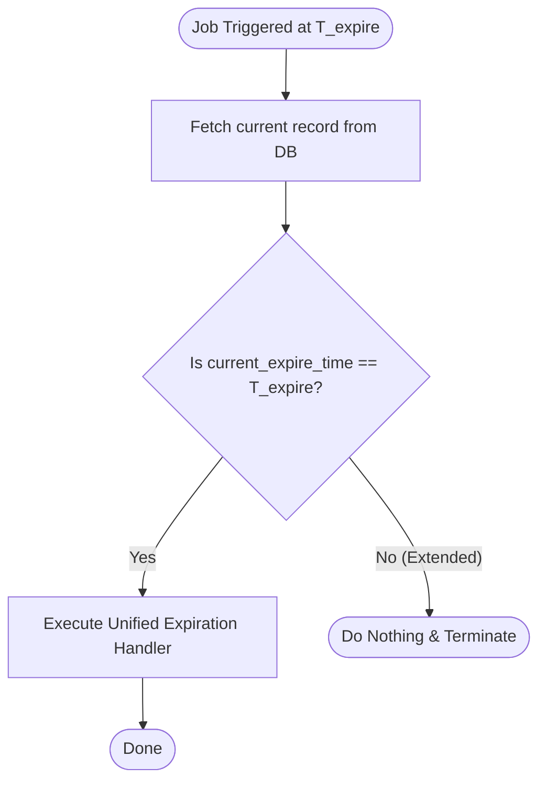
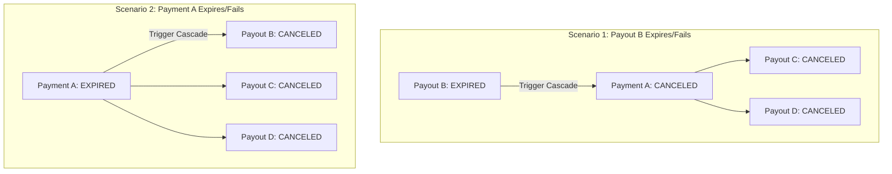

# Backend Specification: Expiration & Cascade Cancellation Handling

## 1. Overview
This document specifies the technical design for managing expiration checks, cascading status updates, and quantity release logic for **Bids**, **Asks**, **Payments**, and **Payouts** in the backend.

The system must run periodic checks to expire stale records, handle cancellation dependencies between payments and payouts, and correctly adjust marketplace inventory when transactions fall through.

### 1.1 Background & Existing Limitations
Currently, the backend schedules several daily cron jobs for expiration checks:
- **00:00 (Midnight):** `handleOrderExpiry()` runs to check order expiration.
- **01:00 / 02:00:** `handleExpiredOrdersUpdate()` and `handleDailyCleanup()` (annotated with `@Cron(CronExpression.EVERY_DAY_AT_2AM)`) run daily cleanups and automated status transitions for orders past their expiration.

**Key Issues with the Current Implementation:**
1. **Lack of Real-time Precision:** A once-daily run is insufficient for time-sensitive expiration, causing delayed status updates that are not reflected on the Frontend in a timely manner.
2. **Missing Cascade Logic:** No mechanism exists to propagate status changes across linked entities (e.g., canceling a parent Payment when a linked Payout expires, or vice versa).
3. **No Automatic Inventory Release:** There is no flow to release locked quantities back to the marketplace when payments or payouts are canceled/rejected.

---

## 2. Cron Jobs & Scheduling Logic

To handle record expiration, the backend implements a unified status-transition service that can be triggered via two scheduling approaches: **EOD (End of Day) Cron** and **High-Frequency Polling or Dynamic Scheduling**.

### 2.1 EOD Expiration Cron
- **Schedule:** Run daily at the end of the day (e.g., `0 0 * * *` or `23:59:00`).
- **Target:** All active `Bids`, `Asks`, `Payments`, and `Payouts` that have reached their expiration timestamp.
- **Action:** Transition their status to `EXPIRED`.

### 2.2 Short-Window Expiration Handling
For records that are scheduled to expire **on the following day** (within the next 24 hours), we need higher precision. The backend can implement one of the two options below:

#### Option A: High-Frequency Polling (Cron)
- **Schedule:** Run every 5 minutes (`*/5 * * * *`).
- **Target:** Active records whose expiration time falls within the next 24 hours and is less than or equal to the current time.
- **Action:** Call the unified expiration handler to mark them as `EXPIRED`.

#### Option B: Dynamic Scheduling / Task Queuing (Recommended)
Instead of polling database tables every 5 minutes, we schedule a one-off delayed job (e.g., via Redis, BullMQ, or a cloud-native task scheduler) targeting the exact expiration timestamp ($T_{\text{expire}}$).

- **Execution Flow:**
  1. When a record is created or updated, schedule a task at $T_{\text{expire}}$.
  2. At execution time $T_{\text{expire}}$, fetch the current record from the database.
  3. **Verification Check:** Compare the scheduled time with the record's current expiration time.
     - **If the expiration time has NOT changed (not extended):** Mark the record as `EXPIRED` and execute the status transition logic.
     - **If the expiration time has changed (extended or modified):** Do nothing (cancel this execution). A new job will have been scheduled for the new timestamp.

> [!IMPORTANT]
> Both the EOD Cron and the short-window scheduler must invoke the **Unified Expiration Handler** to guarantee consistency in status transitions and business logic.

---

## 3. Cascading Cancellations (Interdependent Status Changes)

There is a **1-to-Many (1:N)** relationship between **Payments** and **Payouts**. 
- A single **Payment** is associated with one or more **Payouts** (e.g., `Payment A` is linked to `Payout B`, `Payout C`, and `Payout D`).

When a Payment or a Payout expires, is canceled, or is rejected, the status change must cascade through the linked entities.

### 3.1 Payout Expiration / Cancellation Cascade
If a specific **Payout** expires, is canceled, or is rejected:
1. The associated **Payment** is transitioned to `CANCELED`.
2. **All other Payouts** linked to that same Payment are also transitioned to `CANCELED`.

*Example Scenario:*
- `Payment A` $\rightarrow$ `Payout B`, `Payout C`, `Payout D`.
- `Payout B` expires $\rightarrow$ Status of `Payment A` becomes `CANCELED` $\rightarrow$ Status of `Payout C` and `Payout D` become `CANCELED`.

### 3.2 Payment Expiration / Cancellation Cascade
If a **Payment** expires, is canceled, or is rejected:
1. **All Payouts** linked to that Payment are transitioned to `CANCELED`.

*Example Scenario:*
- `Payment A` $\rightarrow$ `Payout B`, `Payout C`, `Payout D`.
- `Payment A` expires $\rightarrow$ Status of `Payout B`, `Payout C`, and `Payout D` become `CANCELED`.

### 3.3 DocuSign Agreement Cancellation
When a Payout is transitioned to `CANCELED` (either directly due to its own expiration/failure or indirectly via cascade from a canceled Payment), the associated DocuSign agreement for that Payout must also be canceled/voided.
- **Rule:** If a Payout transitions to `CANCELED` status, the backend must trigger the necessary API call to void/cancel the corresponding DocuSign agreement package to prevent outstanding signing requests.

---

## 4. Quantity Release & Inventory Reversion

When a **Payment** or **Payout** transitions to `CANCELED` or `REJECTED`, the allocated quantity must be released. The release behavior depends on the status of the associated **Bid** or **Ask** that initiated the trade:

| Associated Bid/Ask Status | Action Required | Details |
| :--- | :--- | :--- |
| **Expired** | **No action** | The quantity is not returned to the market since the bid/ask is no longer active. |
| **Active (Not Expired)** | **Revert Quantity** | 1. **Decrease** `filled_qty` of the Bid/Ask by the canceled/rejected quantity. 2. **Increase** `remaining_qty` of the Bid/Ask by the canceled/rejected quantity. |

> [!WARNING]
> Database transactions must be used for these status transitions and quantity updates to prevent race conditions and ensure data consistency. Use row locking (`SELECT FOR UPDATE`) on the Bid/Ask record during updating.

### 4.1 Reversion Formula
- `new_filled_qty = max(0, old_filled_qty - released_qty)`
- `new_remaining_qty = old_remaining_qty + released_qty`

