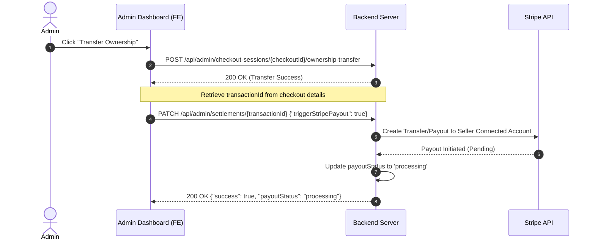
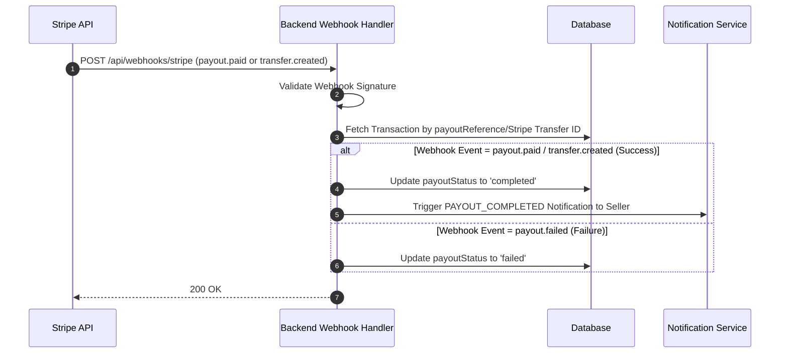

# Backend Specification: Admin Payout Trigger & Stripe Webhook Integration

## Document Version Control

| Version | Summary of changes | Updated by | Date |
| --- | --- | --- | --- |
| 0.1 | Initial specification for triggering payout post ownership transfer and handling payout status updates via Stripe webhooks. | Antigravity | 2026-08-21 |

---

## I. Introduction

### 1. Purpose
This document specifies the technical design and API requirements for triggering payouts to sellers after the Admin transfers cask ownership, and updating the transaction's payout status to `completed` or `failed` via Stripe Webhook events.

### 2. Definitions
| Term | Definition |
| :--- | :--- |
| **Checkout Session** | A session representing a buyer's purchase process for one or more cask variants. |
| **Transaction** | An individual trade unit within a Checkout Session representing a sale from a specific Seller to a Buyer. |
| **Stripe Payout / Transfer** | The transfer of funds from the platform to the Seller's connected Stripe account, or the payout from the Seller's account to their external bank account. |
| **Stripe Connect Webhook** | Webhook events fired by Stripe regarding connected Express/Custom accounts. |

### 3. Business Rules Summary
| Rule Code | Description | Condition / Trigger |
| :--- | :--- | :--- |
| **PAY-BR-1** | Payout status transition rules | Payout status can transition from `not_ready` -> `processing` -> `completed` / `failed`. |
| **PAY-BR-2** | Admin authorization | Only users with the `Admin` role can trigger payouts via `/api/admin/settlements/{transactionId}`. |
| **PAY-BR-3** | Payout triggered after transfer | Payout trigger must only run after ownership transfer is successfully completed. |
| **PAY-BR-4** | Webhook-driven completion | Payout status is only updated to `completed` upon verification of a successful Stripe payout event via webhook. |
| **PAY-BR-5** | Notify on completion | Transitioning payout status to `completed` must trigger the `PAYOUT_COMPLETED` notification to the Seller. |

---

## II. Requirements & Workflows

### 1. Payout Initiation Flow



#### 1.1. API: Trigger Stripe Payout
- **Method:** `PATCH`
- **URL:** `/api/admin/settlements/{transactionId}`
- **Headers:** `Authorization: Bearer <Admin JWT>`
- **Request Body:**
  ```json
  {
    "triggerStripePayout": true
  }
  ```
- **Response (200 OK):**
  ```json
  {
    "success": true,
    "transactionId": "transaction_0d839a3a-bca9-48bb-aed9-03c5d83623f9",
    "payoutStatus": "processing",
    "payoutProcessedAt": "2026-08-21T10:59:12.000Z"
  }
  ```

#### 1.2. Use Case: Trigger Payout (UC-PAY-1)
| Item | Description |
| :--- | :--- |
| **Objective** | Trigger the transfer of funds to the Seller's Stripe connected account for a completed trade transaction. |
| **Actor** | Admin |
| **Trigger** | Admin successfully executes ownership transfer for a Checkout Session. |
| **Pre-condition(s)** | 1. Checkout session status is completed or ownership document uploaded.<br>2. The transaction's `payoutStatus` is `not_ready`. |
| **Post-condition(s)** | 1. Stripe payout/transfer is initiated.<br>2. Transaction `payoutStatus` is updated to `processing`.<br>3. `payoutProcessedAt` is set to the current timestamp. |

**Activity Flow & Business Rules:**
| Step | Action | BR Code | Details |
| :--- | :--- | :--- | :--- |
| 1 | Validate Admin Role | PAY-BR-2 | Verify the requesting user has the `Admin` role. If not, return `403 Forbidden`. |
| 2 | Check Pre-conditions | PAY-BR-3 | Verify the transaction exists and `payoutStatus` is `not_ready`. If already processing or completed, return `400 Bad Request` or return the current status. |
| 3 | Call Stripe Connect API | System | Request a Stripe Transfer (`stripe.transfers.create`) to the seller's connected account (`seller.stripeConnectAccountId`) for the `netPayoutAmount`. |
| 4 | Update Transaction | PAY-BR-1 | Update transaction fields: `payoutStatus` = `"processing"`, `payoutProcessedAt` = `NOW()`, `payoutReference` = Stripe Transfer ID. |
| 5 | Return Response | System | Return 200 OK with the updated transaction details. |

---

### 2. Stripe Webhook Update Flow



#### 2.1. Webhook Endpoint
- **Method:** `POST`
- **URL:** `/api/webhooks/stripe` (or the existing configured Stripe webhook path)
- **Stripe Webhook Reference:** [Stripe Connect Webhooks Documentation](https://docs.stripe.com/connect/webhooks)

#### 2.2. Webhook Event Processing Rules
Backend must handle incoming events for connected accounts. The events to listen to are:

##### Case A: Platform-to-Connected Account Transfer (`transfer.created`)
If the platform uses Destination Charges or Separate Charges and Transfers, the payout is triggered by creating a Transfer object.
- **Event:** `transfer.created`
- **Payload Path:** `event.data.object` contains the Transfer object (with `id` matching `payoutReference`).
- **Processing Logic:**
  1. Extract the Transfer ID: `transferId = event.data.object.id`.
  2. Locate the transaction in the database where `payoutReference = transferId`.
  3. If found, transition `payoutStatus` to `completed`.
  4. Trigger `PAYOUT_COMPLETED` notification.

##### Case B: Connected Account External Payout (`payout.paid` / `payout.failed`)
If the connected Express account automatically/manually transfers funds to their bank account and the system tracks this final leg:
- **Events:**
  - `payout.paid`: External payout succeeded.
  - `payout.failed`: External payout failed.
- **Payload Path:** `event.data.object` contains the Payout object.
- **Processing Logic:**
  1. Extract the Payout ID: `payoutId = event.data.object.id`.
  2. Locate the transaction associated with the Connected Account and payout ID (or map using metadata/payout reference).
  3. Update `payoutStatus`:
     - If `payout.paid` -> Set `payoutStatus` to `completed`, trigger `PAYOUT_COMPLETED` notification.
     - If `payout.failed` -> Set `payoutStatus` to `failed`.

---

## III. Data Model & State Transitions

### 1. Updated Transaction Status Flow
The `payoutStatus` in the `Transaction` entity must follow the state machine below:

```
    [not_ready]
         │
         │ (Admin triggers PATCH API)
         ▼
    [processing]
         │
         ├───────────────(Stripe Webhook Success)───────────────┐
         │                                                      ▼
         │                                                 [completed]
         │                                                      ▲
         └───────────────(Stripe Webhook Failure)──────────┐    │ (Admin manual retry)
                                                           ▼    │
                                                        [failed]─┘
```

---

## IV. Notifications & Side Effects

When the webhook transitions `payoutStatus` to `completed`, the backend must automatically send the following notification:

| # | Trigger Event | Channel | Template | Recipient | Description |
|---|--------------|---------|----------|-----------|-------------|
| 1 | `payoutStatus` transitions to `completed` | In-App & Email | `PAYOUT_COMPLETED` | Seller | Confirms payout of the transaction net amount was successfully completed. |

---

## V. Permissions & Access Control

| Use Case / Action | Anonymous | Buyer | Seller | Admin |
|:---|:---|:---|:---|:---|
| Trigger Payout (`PATCH /api/admin/settlements/{id}`) | ❌ | ❌ | ❌ | ✅ |
| Receive Stripe Webhook (`POST /api/webhooks/stripe`) | ✅ | ❌ | ❌ | ❌ |
